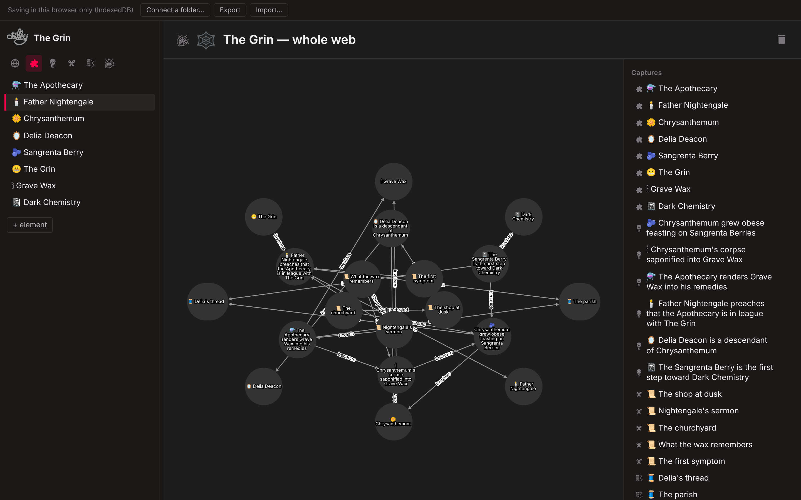
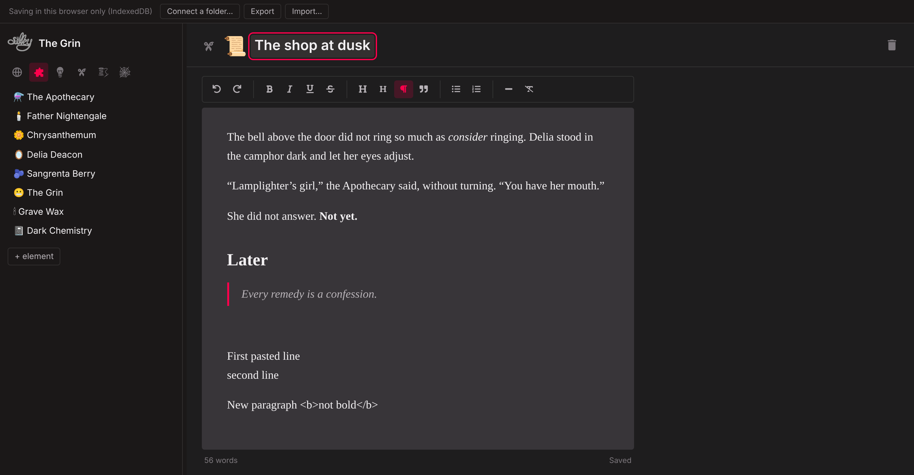
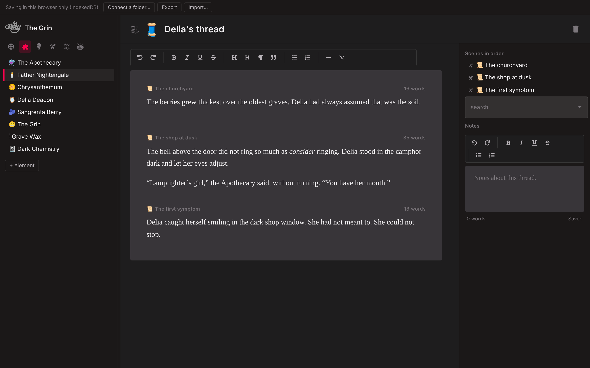

**A graph-native word processor for writers who plan stories non-linearly. Runs in your browser — nothing to install.**

**→ https://brandonjcampbell.github.io/Silky/**

Most writing tools are a stack of pages. Silky is a graph. The things in your story — characters, places, objects, secrets — are nodes. The prose is attached to the graph, not the other way around. You can write the ending first, discover what it needs, and work backwards.

Built for writers who crave dark themes. Your projects stay in your browser (or in a folder you choose); nothing is uploaded anywhere.



## The model

Silky stores a project as four kinds of *actors* and the edges between them:

| Actor | What it is | Edges |
|---|---|---|
| **Element** | A noun in the world — a character, a place, a thing. | |
| **Fact** | Something true in the world. | `INVOLVES` → Element · `DEPENDS_ON` → Element or Fact |
| **Snippet** | A unit of prose. | `APPEARS_IN` ← Element · `REVEALS` → Fact |
| **Thread** | An ordered sequence of snippets — a chapter, a POV, a timeline. | `STARTS_WITH` → Snippet |

Because facts depend on facts and snippets reveal facts, the graph can answer questions a page stack can't: *What does the reader know at this point? What has to be established before this scene can land? Which threads touch this character?*

The graph view is Cytoscape; the editor is a proper writing surface — headings, quotes, lists, scene breaks, keyboard shortcuts — that autosaves as you type.



*A snippet. The scene is on top; below it, the facts this scene reveals and the thread it belongs to. Every list is an edge in the graph.*



*A thread. Its scenes read as one manuscript — edit any of them in place and it saves to its own snippet. Drag the list in the panel to reorder; the manuscript follows. A **web** (the hero image above) captures any set of actors and draws the edges between them — `involves`, `because`, `reveals`, and `then` along threads.*

## Importing a manuscript

If you already have a draft, Silky can build the model from it. **Model** on the project tray connects a language model — any OpenAI-compatible endpoint (OpenAI, OpenRouter, a local Ollama, LM Studio or vLLM) or Anthropic. The key stays in your browser's localStorage and is sent only to the address you enter.

**Import manuscript** then takes pasted text or a `.txt`/`.md` file, splits it into scenes at headings and scene breaks (`* * *`, `---`, "Chapter …"), and shows the split before anything is sent. With a model connected, each scene is read once with a running cast list; the model returns the elements it introduces and the facts it establishes, and a final pass links causes to effects. The result is a new project: a snippet per scene, elements, facts wired by `involves`, `revealed_by` and `because`, a **Manuscript** thread running the scenes in order, and a web of the whole thing. Without a model, the same import still gives you the scenes and thread.

Everything it produces is a draft meant to be pruned.

## Neo4j

Projects live on disk as JSON, so the app runs with no database. `silkyToCypher.js` exports a project into Neo4j as `Element`, `Fact`, `Snippet`, and `Thread` nodes with the edges above, so you can run Cypher over your own narrative:

```cypher
// Every fact a character's scenes reveal, and what those facts depend on
MATCH (e:Element {name: "Mara"})-[:APPEARS_IN]->(s:Snippet)-[:REVEALS]->(f:Fact)
OPTIONAL MATCH (f)-[:DEPENDS_ON]->(d)
RETURN s.name, f.name, collect(d.name) AS prerequisites
```

I demoed this at GraphConnect 2022 (*Weaving Tangled Webs: Using Graphs to Author Content*).

## Running it

**Just open it:** https://brandonjcampbell.github.io/Silky/

Projects are saved in your browser (IndexedDB). In Chrome or Edge, **Connect a folder** from the bar at the top to also mirror every project to a real directory on disk as plain JSON files; anywhere else, **Export / Import** moves projects around as a single JSON file. Nothing leaves your machine either way.

**Run it locally:**

```bash
npm i
npm start          # http://localhost:3000
```

**Export a project to Neo4j** (edit the bolt URL and credentials at the top of the script first):

```bash
node silkyToCypher.js
```

### Desktop app (optional)

Silky began as an Electron app and still builds as one. Projects then live in `~/.silky/<project>/` as the same JSON files.

```bash
npm run electron   # React dev server + Electron, concurrently
npm run build && npx electron-packager . --overwrite   # packaged executable
```

## How storage works

All file I/O goes through `src/storage/`, which picks a backend at startup. In the browser that is an in-memory mirror of a virtual filesystem, hydrated from IndexedDB before React mounts and written through after every change, with optional one-way sync to a real folder via the File System Access API. Under Electron it is Node `fs`. The components call the same synchronous `loadDir` / `loadFile` / `saveFile` utilities either way, so the two builds share every line above the storage layer.

The compiled app is also published to the [`build`](https://github.com/brandonjcampbell/Silky/tree/build) branch on every push, so `git clone -b build` and opening `index.html` works with no npm at all.

## Status

Silky is a working prototype and a personal tool, not a supported product. It is very much a work in progress — use caution when writing in it, keep backups (Export is one click), and expect rough edges.

## License

[CC0 1.0 (Public Domain)](LICENSE.md)
