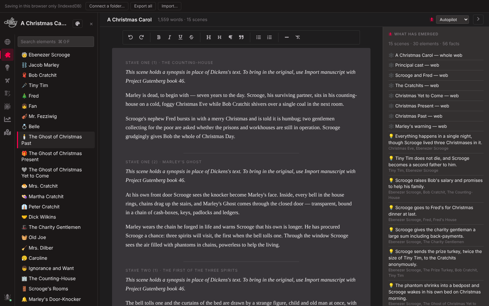
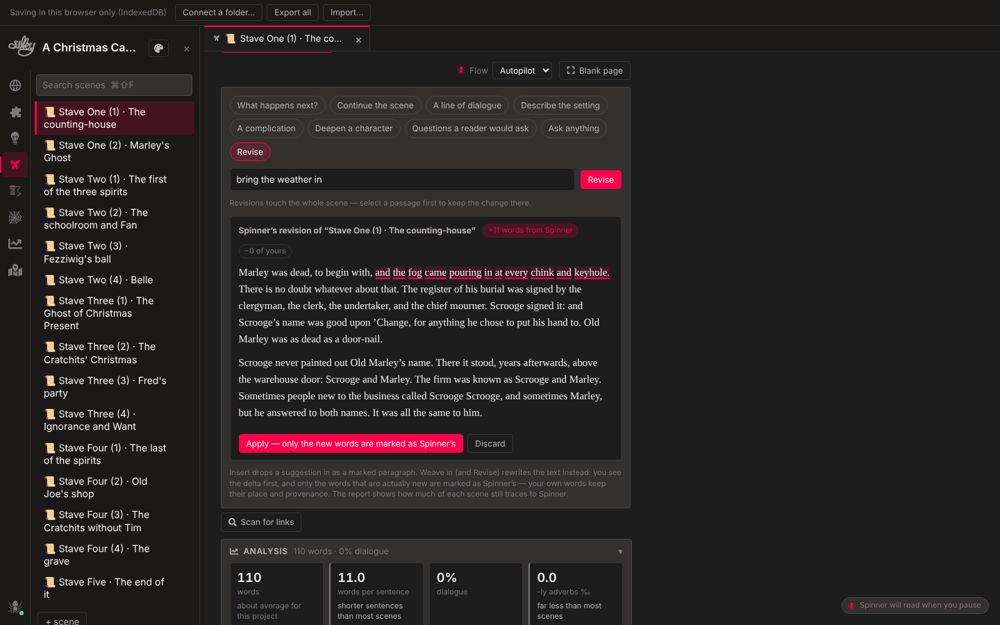
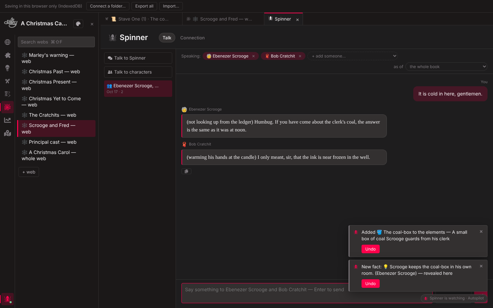
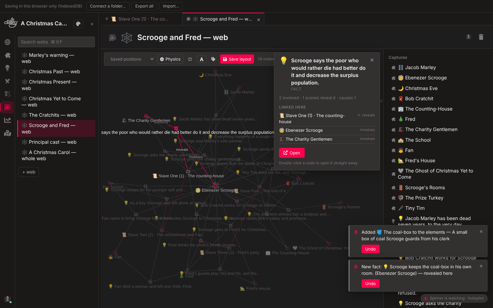
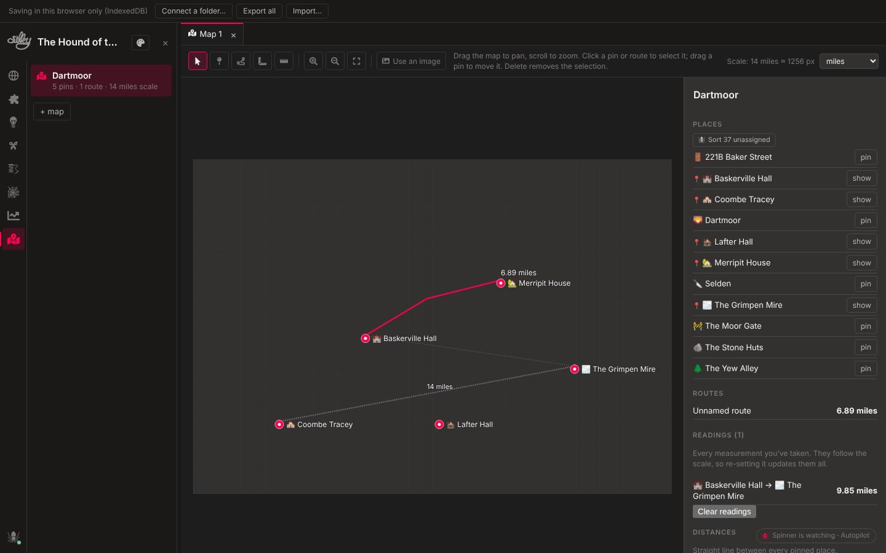
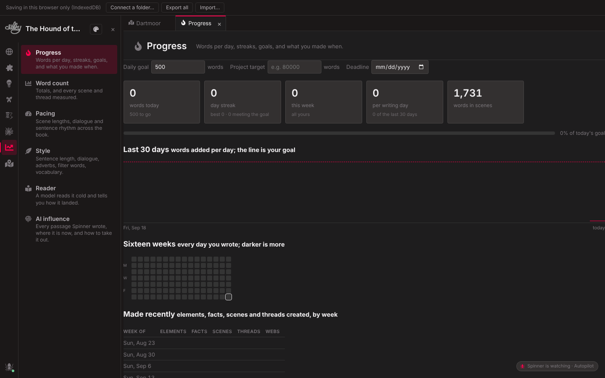
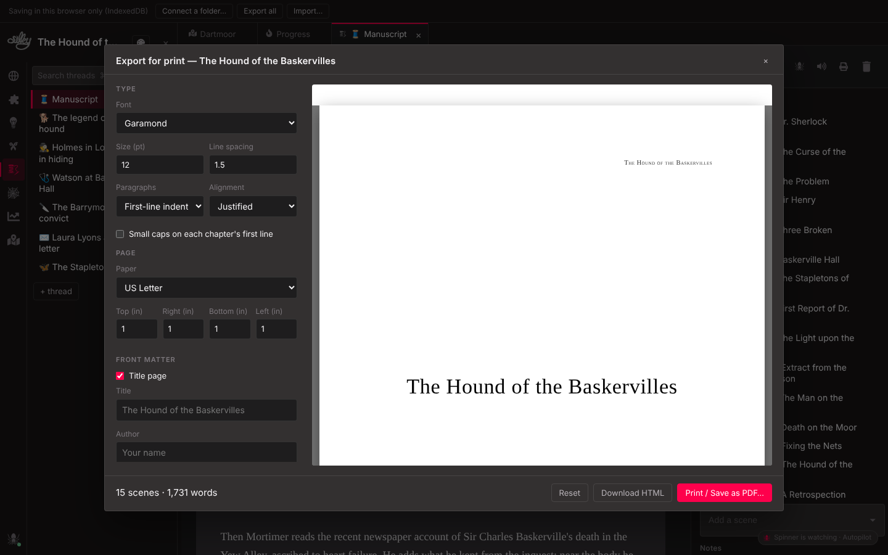
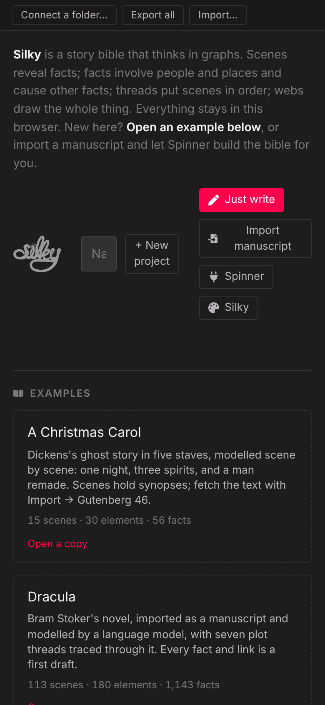

**A narrative development assistant. Write prose on a blank page; the story bible — people, places, facts, scenes, threads — builds itself behind you, and you can read it back as a manuscript, a wiki, a graph or a map. Runs in your browser, nothing to install.**

**→ https://brandonjcampbell.github.io/Silky/**

Most writing tools are a stack of pages, and most "AI writing tools" put a model in front of the writer. Silky does neither. It is a word processor for fiction whose document is a graph: the things in your story are nodes, the prose hangs off them, and an assistant called **Spinner** keeps the graph honest as you type — noticing who has walked into a scene, what has just become true, which chapter a scene belongs to — without ever writing your book for you unless you ask. Everything stays in your browser (or a folder you choose); nothing is uploaded anywhere.



*Open a project and this is where you land. Type. Scenes, people and facts appear on the right as they emerge; click any of them to open it in a tab. Ctrl+Enter or a line of `***` starts a new scene.*

## How it works

Silky stores a project as five kinds of thing and the edges between them:

| Kind | What it is | Edges |
|---|---|---|
| **Element** | A noun in the world — a *character*, a *location*, or a *thing*. | |
| **Fact** | Something true in the story. | `involves` → Element · `because` → Fact |
| **Scene** | A unit of prose — where the writing happens. | `reveals` → Fact |
| **Thread** | An ordered run of scenes: the manuscript, a subplot, one character's arc. | `sequences` → Scene |
| **Web** | A graph of any set of the above, drawn with its edges. | `captures` → anything |

Because scenes reveal facts and facts cause facts, the graph answers questions a page stack can't: *What does the reader know at this point? What has to be established before this scene can land? Which threads touch this character? If I change this, what goes stale?*

You never have to build the graph by hand. You can — every page has its lists, and the sidebar has a tab per kind with search — but the point of Silky is that you mostly don't.

## Spinner

Spinner is the model behind Silky. Connect one from the spider at the foot of the sidebar: **In this browser** runs a small open model (Qwen 2.5, Llama 3.2 or Phi 3.5, 1.5B–7B) on your own GPU through WebGPU — downloads once, then works offline with nothing leaving your machine; or point it at any OpenAI-compatible endpoint (OpenAI, OpenRouter, a local Ollama, LM Studio, vLLM) or Anthropic. Keys stay in your browser and go only to the address you enter. The small in-browser models are fine for keeping the bible and reader notes; for character chats and revision, a larger model is the real experience.

**Flow** is Spinner watching you write. Pick a level — *Ask* (toasts: link this fact? add this person?), *Auto-link* (links on its own, asks before creating), or *Autopilot* (links, creates, names scenes, suggests a title for the book, and tells you what it did, each with Undo). It reads when you pause, never while you type, and declined suggestions stay declined.

**Weave in.** Ask Spinner for ideas on a scene — what happens next, a line of dialogue, a complication, describe the setting, or anything you type — and either insert a suggestion as a marked paragraph or *weave it in*: Spinner rewrites the scene (or just the passage you selected) to work it in, you see the delta first, and only the words that are actually new are marked as Spinner's. *Revise* takes free directions the same way: "tighten the dialogue", "bring the weather in".



**Provenance.** Every passage Spinner wrote is marked in the text and logged. Typing beside or inside one lands outside the mark; only editing its own words counts as rewriting it. *Show AI text* underlines them all; the **AI influence** report says how many words in each scene still trace to Spinner (even after you've rewritten them), lists every insertion, and can un-mark or remove any of them — one passage, one scene, or everything. If you ever need to state what a model contributed, the answer is already there.

**Talk.** The Spinner tab is a conversation about the book, briefed with a digest of the project and whatever you bring into the room. It asks more than it tells, offers sharply different options with their costs, cites the project's own facts, and won't write the scene unless asked. **Talk to characters** puts the cast in the room instead: each is played strictly from its dossier — description, the facts that involve it, the scenes it appears in, a passage for voice — and knows nothing beyond that; set *as of* a scene and they know only what the book has established by then. Places and things can be in the room too, present but not sentient. Press *Let them talk* and they carry on among themselves.



**Scan, readers, wiki.** *Scan for links* reads a scene and proposes what it should connect to. **Reader** plays a reader of your choosing — a first-timer, an impatient commuter, a genre devotee, a critic, an acquiring editor, or one you describe — reading the manuscript cold with a running memory, scoring and reacting scene by scene, then writing you a letter; run several and compare. The **wiki** turns the project into a cross-linked encyclopedia (and downloads as one HTML file); with a model connected it drafts an article per element from the facts alone, so the wiki never knows more than the book does.

## Reading it back

**Threads** read as one continuous manuscript — edit any scene in place and it saves to its own file; drag the list to reorder. **Webs** draw any set of things with their edges; a **Physics** toggle turns a web into a live force simulation, and clicking a node opens a details panel with everything linked to it — click to walk the graph, double-click to open.



**Maps.** Mark elements as locations and pin them on a map — an image you upload, or a blank gridded sheet. Set a scale (two points and the distance between them), draw routes and read their lengths, measure between any two points; every reading is kept. Distances between every pinned place are tabulated.



**Analyses.** Word count, pacing (scene lengths, dialogue share, sentence rhythm), style (sentence variance, filter words, adverbs, reading grade), the reader notes above, AI influence, and **Progress**: words per day against a goal, streaks, a sixteen-week heatmap, what you made each week, and — with a target and a deadline — the pace you need and when you'll finish at the pace you have.



**History and impact.** Every save leaves a version (collapsed by the two minutes) with a word-level diff and restore. The Impact panel on anything shows what depends on it — and flags scenes last edited before a fact they state changed. Rename an element and it offers to carry the new name through the prose.

**Export for print.** A thread or a scene typeset with your own font, size and leading, paper and margins, title page, running header and chapter headings, previewed as pages and printed or saved as PDF from the browser; or downloaded as HTML.



**Read aloud** with the browser's own voices, a sentence at a time, from the cursor. And it all works on a phone.

<p align="center"></p>

## Starting

The tray offers three ways in. **Just write** makes a project and lands you on the page. **Import manuscript** takes pasted text, a `.txt`/`.md`, or a Project Gutenberg book number, splits it into scenes at headings and breaks, and — with a model connected — extracts the cast, the facts each scene establishes, the causal links, and the separate plot threads, building a Manuscript thread and a web per thread. Or open an **example**: *Dracula* (113 scenes, 180 elements, 1,143 facts, seven threads — the import run on the whole novel), *The Hound of the Baskervilles* and *A Christmas Carol* (hand-modelled with causal chains; their scenes hold synopses until you fetch the text from Gutenberg, 2852 and 46).

Projects are saved in the browser's IndexedDB and listed on the tray; **Export** writes one as a single JSON file and **Import** reads one back. Or connect a folder and Silky saves there as plain files.

## Neo4j, and the desktop build

Projects live as JSON, so nothing needs a database. `silkyToCypher.js` exports a project into Neo4j as `Element`, `Fact`, `Scene`, and `Thread` nodes with the edges above, for Cypher over your own narrative. An Electron build of the same app is available for those who want it on the desktop; the browser version is the main one.

## Development

```
npm install
npm start        # http://localhost:3000
npm run build    # static site in build/
```

React 17 on Create React App; graphs by Cytoscape and a small force simulation of our own; maps in SVG; no server. GitHub Actions builds `main` to GitHub Pages and pushes the compiled app to the `build` branch.

Silky is Brandon Campbell's project. A good chunk of what's described here was built in a long session with Claude; the ideas are Brandon's, and the AI influence report applies to the code too.
